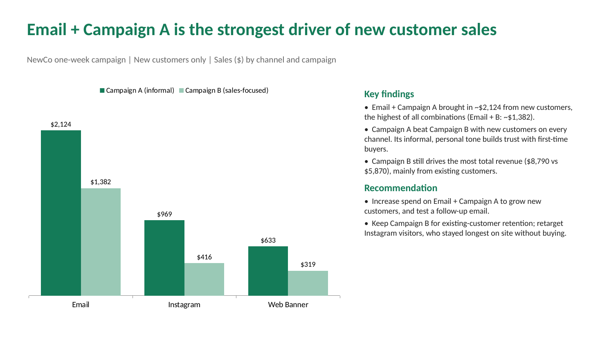

# 📈 BCG – Campaign Performance Analysis (New Customer Growth)

**Forage job simulation · BCG Introduction to Data for Decision Makers · Nov 2026**
[View credential](https://www.theforage.com/completion-certificates/SKZxezskWgmFjRvj9/Pchc5rEGyCeozqY5Z_SKZxezskWgmFjRvj9_6aeda13e3a37e82da041028f_1794416537282_completion_certificate.pdf)

**Tools:** Excel (Pivot Tables, Slicers, Pivot Charts) · PowerPoint

---

## Business question
A big-box retailer (NewCo) ran a one-week campaign with **two message styles** (A: informal, B: sales-focused) across **three channels** (Email, Instagram, Website Banner).
> *"Which campaign + channel combo should we double down on to grow **new customer** sales – and why?"*

## What I did
1. Reviewed 500 campaign interactions (campaign, channel, customer type, conversion, time on site, sales).
2. Built a pivot table of **sales by channel × campaign**.
3. Added a **Customer Type slicer** to isolate **new customers**.
4. Compared overall vs new-customer results, checked time-on-site for non-buyers, and built a one-slide recommendation for the client.

## Key findings

**All customers – sales ($)**

| Channel | Campaign A | Campaign B |
|---|---|---|
| Email | 2,952 | **4,957** |
| Instagram | 2,163 | 1,711 |
| Web Banner | 754 | 2,123 |
| **Total** | 5,870 | **8,790** |

**New customers only – sales ($)**

| Channel | Campaign A | Campaign B |
|---|---|---|
| Email | **2,124** | 1,382 |
| Instagram | 969 | 416 |
| Web Banner | 633 | 319 |
| **Total** | **3,727** | 2,117 |

- Overall, the sales-focused **Campaign B** wins – mostly driven by existing customers.
- For **new customers the result flips**: the informal **Campaign A** wins on every channel, and **Email + Campaign A** is the strongest combination.
- Instagram visitors who didn't buy spent the longest time on site (≈45 s) – a good retargeting audience.

## Recommendation
Prioritise **Email + Campaign A** for new-customer growth and test a follow-up email; keep Campaign B for existing-customer retention. Key trade-off: **new customer growth vs short-term revenue**.

📊 [Recommendation slide (PDF)](deliverables/recommendation_slide.pdf) · [PPTX](deliverables/recommendation_slide.pptx)

---

### Notes
- The campaign dataset is provided by Forage for simulation use only and is **not included** here.
- This is a Forage virtual job simulation, not employment with BCG.

👤 **Rehan Deshmukh** · [LinkedIn](https://www.linkedin.com/in/rehan-akhtar-deshmukh-25bb93269/) · [GitHub profile](https://github.com/rehan-deshmukh1110)
